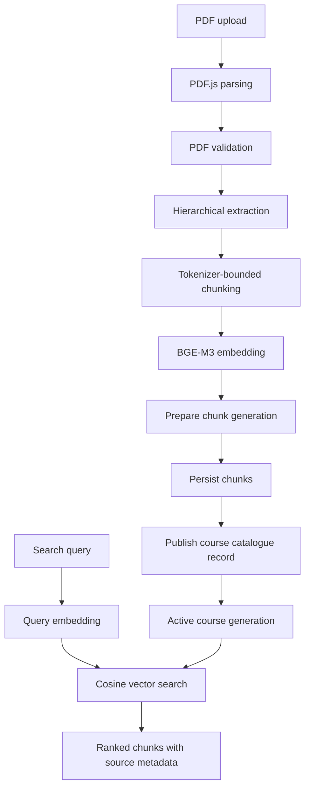

# System Architecture

## 1. Purpose and scope

The Electron RAG Server is a local Node.js/TypeScript backend that ingests PDF course material, reconstructs document hierarchy, creates tokenizer-bounded text chunks, generates dense embeddings, stores course metadata and vectors in LanceDB, and exposes semantic retrieval over the stored content.

The current package is a backend service. The name "Electron RAG Server" is retained from the larger project; this package itself starts an Express HTTP server and does not create an Electron renderer window.

## 2. Runtime components

| Component | Responsibility |
| --- | --- |
| Express application (`main.ts`) | HTTP routes, multipart upload handling, JSON responses, error mapping, OpenAPI document and Swagger UI. |
| PDF.js adapter (`pdf/pdfjs-document-parser.ts`) | Reads PDF text items, page geometry and font sizes; produces normalized parser output and validator lines. |
| Validator (`validator/`) | Enforces page-count, font-size and explicit heading-closure rules before extraction proceeds. |
| Extractor (`extractor/`) | Reconstructs a nested Document/Heading/Paragraph tree with page and line ranges. |
| Chunker (`chunker/`) | Traverses the hierarchy, retains heading context and splits content to the configured token limit. |
| BGE-M3 tokenizer (`embedding/bge-m3-tokenizer.ts`) | Counts the complete embedding input, including special tokens. |
| Embedding service (`embedding/embedding-service.ts`) | Generates normalized 1024-dimensional dense vectors from the local ONNX model. |
| VDB manager (`vdb-manager/`) | Coordinates course identity, duplicate checks, lifecycle operations, persistence and retrieval. |
| LanceDB | Persists the course catalogue and chunk vectors locally. |

## 3. High-level data flow

The create pipeline performs identity/duplicate validation before PDF processing. Persistence is performed only after parsing, validation, extraction, chunking and embedding have completed successfully.

## 4. Dependency boundaries

- `PdfDocumentParser` is an abstraction consumed by the extractor. The production adapter is PDF.js.
- The chunker receives a token-counting function. It does not hard-code a tokenizer implementation.
- The create pipeline receives loaders for the tokenizer and embedding service. Model loading is lazy and cached by the pipeline instance.
- The repository isolates LanceDB operations from the higher-level VDB manager.
- `VdbManagerService` is the application-facing façade used by HTTP routes.

These boundaries allow tests to inject controlled parser, tokenizer, embedder and persistence dependencies without requiring a live model for every unit-level test.

## 5. Persistence model

Two LanceDB tables are used:

- `courses`: one catalogue row per course, including the serialized extraction tree and the active generation identifier.
- `course_chunks`: one row per chunk generation entry, including the dense vector, source text, embedding input, heading path and source range.

A course can have only one generation marked active in its catalogue record. Retrieval first reads the catalogue and filters vector search to those active generation IDs and the matching embedding model ID.

See [DATA-MODEL.md](./DATA-MODEL.md) for field-level details and [VDB Manager README](../vdb-manager/README.md) for lifecycle behavior.

## 6. Replacement consistency

LanceDB does not provide a cross-table transaction for the catalogue and chunk writes used here. Replacement therefore uses a staged generation and compensating cleanup:

1. Process the replacement PDF completely.
2. Write its chunk rows under a new generation ID.
3. Replace the catalogue row so the new generation becomes active.
4. Remove chunks belonging to inactive generations.

If the catalogue switch fails, the repository attempts to restore the prior catalogue record and remove the prepared generation. A cleanup failure after the switch can leave stale inactive chunks behind; active-generation filtering prevents those stale rows from being returned as current search results. This is not an atomic multi-table transaction.

## 7. Runtime constraints

- Node.js 22.13.x or 24.0.0+ (Node.js 23.x is outside the package engine range).
- Local model files are required for ingestion and semantic query embedding.
- The default embedding dimension is 1024.
- The default maximum embedding input is 512 BGE-M3 tokens, including heading context.
- The HTTP upload limit is 25 MiB and one file per request.
- The default HTTP port is 3000; `PORT` overrides it.

## 8. Explicit non-goals / current limitations

- No automatic LanceDB schema migration is performed.
- No remote model download is performed by the runtime model loaders.
- No cross-process distributed write lock is implemented; write serialization is within one server process.
- The repository persists extracted hierarchy and chunk vectors, not the original PDF bytes.
- Semantic search returns ranked chunks; answer generation is outside this package's current retrieval endpoint.
